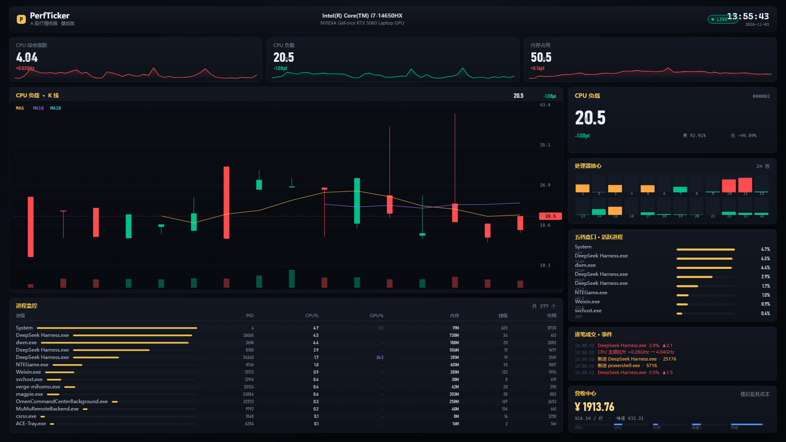

# PerfTicker 行情壁纸（Wallpaper Engine · Web 壁纸）

把 PerfTicker「任务管理器做成 A 股行情终端」的观感搬到桌面壁纸。壁纸本身是**只读展示**，
所有指标、K 线、盘口、逐笔、营收都由本地 PerfTicker 数据桥实时推送；需要交互时按全局热键
`Ctrl+Alt+P` 唤出原生面板。



## 一、它是怎么工作的

```
┌────────────────────────┐  WS 推送/HTTP  ┌──────────────────────────┐
│ PerfTicker.exe          │ 127.0.0.1     │ Wallpaper Engine (CEF)    │
│  --sensor  无头采样      │ ───────────►  │  wallpaper/index.html     │
│  或主程序（内置桥）      │  /ws          │  Canvas 全屏自绘            │
└────────────────────────┘  /api/*        └──────────────────────────┘
```

- PerfTicker 内置一个**回环数据桥**（仅监听 `127.0.0.1`，不对外）：优先用 **WebSocket**（`/ws`）推送，连上即发 hello、之后每秒推 tick；同时保留 HTTP 接口（`/api/*`）作兼容与回退。
- 壁纸端是纯前端（Canvas 2D 自绘）：优先订阅 `/ws` 实时推送，WS 不可用时自动退回按秒轮询 `/api/tick`，按需拉 `/api/history` 画 K 线。
- Web 壁纸跑在 CEF 沙箱里，**读不到 PDH/NVML、也不能跑 .NET**，所以必须由原生进程采集、经回环桥喂给壁纸——这是与「Application 类型壁纸」完全不同的可行路线。
- 连接失败时壁纸自动进入**离线演示**（合成数据），保证桌面永不空白；检测到数据桥后自动切换为实时。

## 二、快速开始

### 1. 启动数据源（二选一）

**A. 无头数据桥（推荐，常驻托盘，不占窗口）**

```powershell
# 发布版
PerfTicker.exe --sensor

# 或开发版
dotnet exec .\PerfTicker\bin\Debug\net10.0-windows\win-x64\PerfTicker.dll --sensor
```

可选参数：`--port 51789`（默认 51789，被占用自动顺延）、`--interval 1000`（采样毫秒）。

启动后托盘出现「PerfTicker 数据桥」，并在
`%LOCALAPPDATA%\PerfTicker\bridge.json` 写入 `{"url","port","protocol","pid"}`。
浏览器打开 `http://127.0.0.1:51789/api/hello` 能返回 JSON 即成功。

**B. 直接开主程序**

主程序启动时会自动在 51789 起监听数据桥，无需额外参数；`Ctrl+Alt+P` 可从任意前台唤出主面板。

### 2. 在 Wallpaper Engine 中导入

1. 打开 Wallpaper Engine →「创建壁纸 / Create Wallpaper」→ 选择 **Web** 类型；
2. 指向本 `wallpaper` 文件夹（含 `project.json`、`index.html`）；
3. 应用后壁纸即开始取数。也可在 WE 编辑器里「打开壁纸文件夹」后把工程另存/发布为 `.pkg`。

> 本工程 `project.json` 已按 WE 的 Web 壁纸格式写好（`type: web`、`file: index.html`、`preview: preview.png`）。

## 三、目录结构

```
wallpaper/
├─ project.json        # Wallpaper Engine 工程描述
├─ index.html          # 入口（仅承载 canvas + 按序加载脚本）
├─ preview.png         # 预览图（1080p 实拍）
├─ preview_2k.png      # 预览图（1440p）
└─ js/
   ├─ theme.js         # 配色/字体/圆角卡片/文本工具（对齐原生 Theme.cs 深色主题）
   ├─ chart.js         # K线 + MA5/10/20 + 成交量 + 走势线 + 横条
   ├─ panels.js        # 标题栏/指数卡/标的详情/核心网格/盘口/逐笔/营收
   ├─ procs.js         # 进程监控表
   └─ app.js           # 数据桥客户端 + 布局 + 渲染循环 + 离线演示
```

## 四、数据接口（前端契约）

| 方法/路径 | 说明 |
|---|---|
| `GET /ws` | **WebSocket 推送（优先通道）**：握手后先发 hello，此后每 1s 推一帧 tick；前端断线 3s 自动重连 |
| `GET /api/hello` | 基础信息：版本、CPU/GPU 名称、核数、指标目录、周期、配色 |
| `GET /api/tick` | 每采样一帧的完整快照（含指标、核心、内存、GPU、磁盘/网络、进程盘口、逐笔、营收） |
| `GET /api/history?code=&period=` | 指定指标的 K 线（最多 240 根，按 period 聚合） |
| `GET /api/spark?code=&n=` | 指定指标的近期走势数组 |
| `POST /api/cmd` | 下发命令（暂停/配色/切换标的/周期/采样间隔/营收/排序/唤起主窗）。**必须带请求头 `X-Requested-With: PerfTicker`**，否则 403（防跨站）。 |

所有响应带 `Access-Control-Allow-Origin: *`（仅回环可达，风险可控）。

## 五、设计取舍与已知限制

- **只读展示**：Web 壁纸的点击会被桌面图标层拦截、键盘不被转发，因此壁纸不做交互控件；交互回到原生面板（`Ctrl+Alt+P`）。
- **双传输通道**：WebSocket 推送为主、HTTP 轮询兜底；CEF 内 WS 可用，断线 3s 自动重连。
- **不再走「Application 类型壁纸」**：WE 2.8.42 起已把 Application 类型移出创意工坊（安全原因），且该路线会与壁纸层抢 Z-order（原 README 已记录失败）。
- **端口顺延**：若 51789 被占用，壁纸会自动扫描 51789–51808 找可用桥，无需手动改。
- **GPU 指标仅 N 卡**：NVML 只对 NVIDIA 有效，A 卡/核显时 GPU 卡片显示占位。
- **性能**：桥只在有壁纸请求时推送，采样线程优先级 BelowNormal；壁纸端 30fps 自绘，通常 <1% GPU。

## 六、故障排查

| 现象 | 处理 |
|---|---|
| 壁纸显示「离线演示」 | 确认 `--sensor` 或主程序在跑；浏览器访问 `http://127.0.0.1:51789/api/hello` 验证 |
| 端口冲突 | 看 `%LOCALAPPDATA%\PerfTicker\bridge.json` 里的实际端口 |
| 壁纸空白 | 该版本 WE 的 CEF 过旧可能不支持部分绘制，更新 WE |
| 命令行窗口闪退 | 用 `dotnet exec <dll> --sensor` 方式先验证，日志在 `%LOCALAPPDATA%\PerfTicker\diag.log` |
